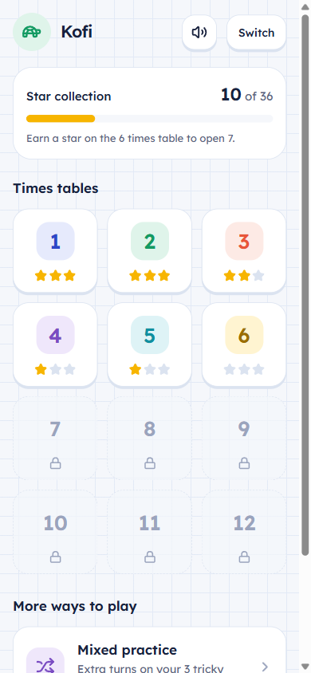
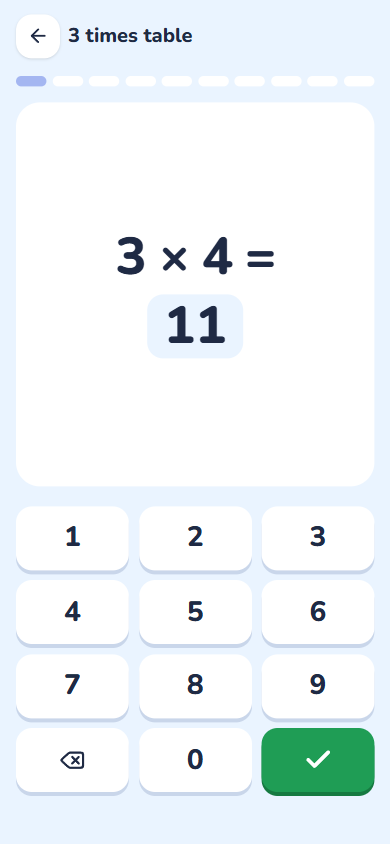
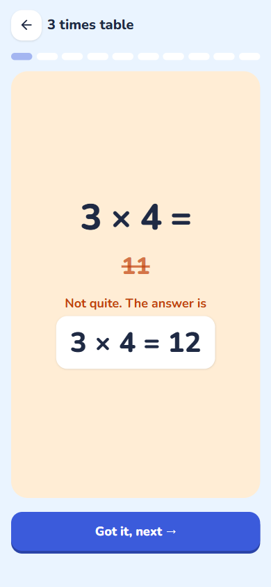
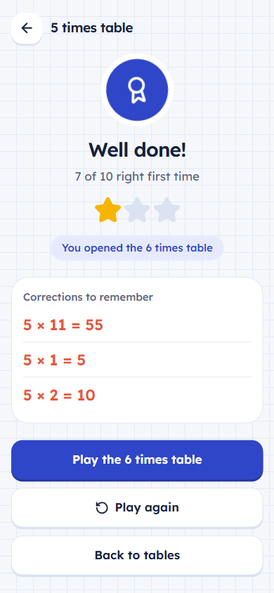
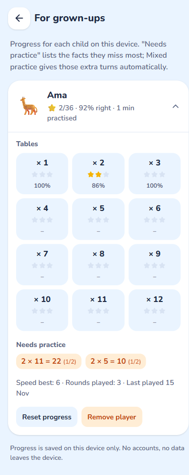
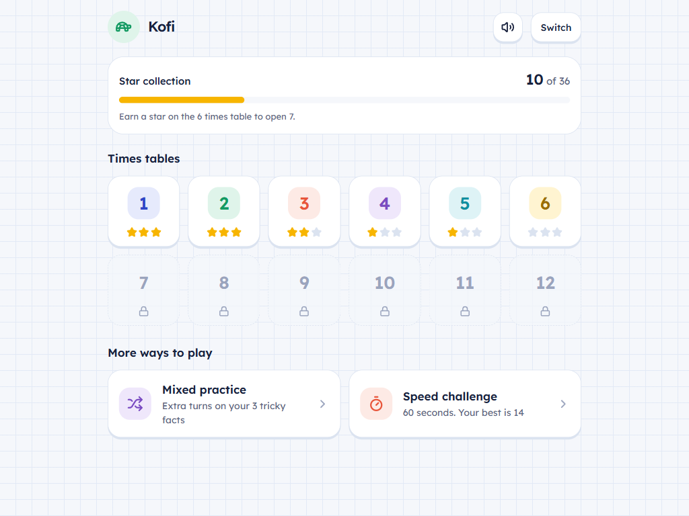

<div align="center">


# Multiply

**Times-tables practice for children: tables 1 to 12 with stars, mixed review and a speed challenge. Works offline.**

[](https://github.com/ohenemanaf/multiplyapp/actions/workflows/ci.yml)

**[Play it: ohenemanaf.github.io/multiplyapp](https://ohenemanaf.github.io/multiplyapp/)**


[](LICENSE)

</div>

| Choose a table | Marked right | Corrected | Results | Grown-up view |
|---|---|---|---|---|
|  |  |  |  |  |

## Design

The whole app is built around a **squared maths exercise book being marked by the teacher**:

- Every question is written on squared paper with a red margin line.
- A right answer gets a green tick **stamped** beside it.
- A wrong answer gets a pen stroke through it, with the correction written underneath.

**Typeface:** [Lexend](https://www.lexend.com/), which was designed to make text easier to read for young and struggling readers. Its numbers stay clear at large sizes.

**Icons:** all icons are sharp vector [Lucide](https://lucide.dev) icons at a single stroke weight, with no emoji. That includes the twelve animal avatars and the result medals.

**Colour:** six "coloured pencil" colours (cobalt, leaf, coral, plum, teal and sun), each with a pale wash. Each times table keeps the same colour everywhere it appears.

**Screen sizes:** phones get one column. On tablets, the home screen spreads out while the game stays a comfortable phone-width page.



## How it works

- **Players:** each child picks a name and an animal (from 12 illustrated animal icons). There are no passwords, so siblings or a class can share one tablet.
- **Times tables 1–12:** each round is 10 questions from one table.
  - 10 right first time earns ★★★, 8 or more earns ★★, and 6 or more earns ★.
  - One star unlocks the next table. Tables 1 and 2 are open from the start.
- **Learning from mistakes:** a wrong answer is crossed out, the correct fact is shown clearly, and that question comes back at the end of the round for another try.
- **Mixed practice:** 10 questions from every open table, chosen more often from the facts that child gets wrong.
- **Speed challenge:** as many answers as possible in 60 seconds, with a personal best. A wrong answer flashes the correct one and costs no points.
- **For grown-ups:** opened by **pressing and holding**, so children don't wander in. It shows each child's stars, accuracy per table, time practised, the facts they miss most, and options to reset progress or remove a player.

**Designed for children aged about 6–10:**
- Big number pad, with keyboard support (digits, Backspace, Enter) on computers
- Gentle sounds generated in the browser, so there are no audio files, plus vibration on phones
- Encouraging messages with no red error buzzer
- Animations respect the device's "reduce motion" setting

## What changed from v1

v1 was a 55-line quiz. It:

- reloaded the page after every answer
- showed *"Your score is below 0. Don't give up"* every time a new child opened it
- displayed a count as a percentage
- never showed the correct answer
- asked random questions from 1×1 to 12×12 with no way to practise a single table

## Tech

- React 19, Vite 8 and Tailwind CSS 4, with the Lexend font and Lucide icons bundled, so it works offline
- The game rules are plain functions with injected randomness (`src/lib/game.js`), which keeps them fully unit-tested
- Progress is saved in `localStorage` on the device. No accounts, and no data leaves the device.
- A service worker precaches the app, so it works with no internet after the first visit.

```bash
npm install
npm run dev        # http://localhost:5173
npm test           # 17 tests: rounds, stars, unlocking, weak-fact weighting, speed, answers
npm run build      # static site in dist/
```

## Deploying

It deploys automatically. Every push to `main` runs the tests, builds the app and publishes `dist/` to the `gh-pages` branch (see `.github/workflows/deploy.yml`), which GitHub Pages serves at https://ohenemanaf.github.io/multiplyapp/.

The app uses relative paths, so the same build also works at a domain root (Vercel or Netlify).

## License

[MIT](LICENSE)

## Author

**Abdul Manaf Ali** · [@ohenemanaf](https://github.com/ohenemanaf)
